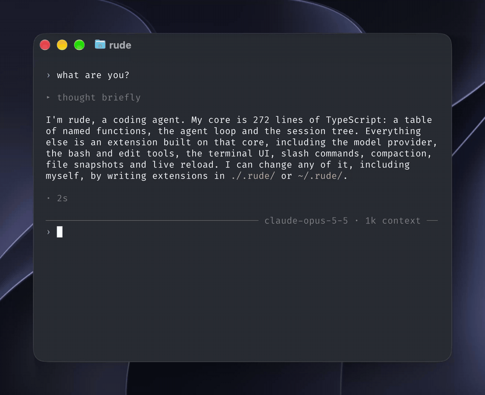

# rude

A rudimentary coding agent.



The entire program is a table of named functions, all of which can be replaced with `def` or wrapped with `advise`. That's the extension API. Config lives in `~/.rude/init.ts`.

It's a small thing for playing with and learning from, not a hardened tool. **It runs whatever shell commands the model chooses, without asking first**, in the directory you start it in. Use it somewhere you're happy to have changed. **Only run it in repositories you trust:** it automatically executes project-local `.rude/*.ts` extensions at startup, including for `rude doc` and `rude apropos`, before making any model request.

Needs [Bun](https://bun.sh) 1.3 and an [Anthropic API key](https://console.anthropic.com/). There are no other dependencies. Developed and tested on macOS, in Ghostty and tmux. Linux should work but is untested; Windows won't, since it relies on bash and Unix process groups. Newer Bun versions are untested too: Esc handling reaches into Bun's readline internals.

It defaults to Claude Opus 5.5 at high effort, which adds up over long sessions. Switching to Sonnet is shown below.

```bash
bun add -g @amackera/rude   # or: npm i -g @amackera/rude (Bun still has to be installed)
# or, to hack on it: git clone https://github.com/amackera/rude && ln -s "$PWD/rude/rude" ~/.local/bin/rude
export ANTHROPIC_API_KEY=...
rude                        # interactive; Shift-Enter for a newline, Esc or Ctrl-C cancels a turn, Tab shows what it's doing
                            # type while it works to steer it; /help lists the slash commands
rude -p "fix the failing test"
rude -c                     # continue the latest session here; -r to pick one
rude apropos session        # list functions
rude doc build-context      # doc and source of one
bun test
```

There are only two tools: `bash` and `edit`. Sessions are stored as JSONL trees in `~/.rude/sessions/`, and every request/response is logged to `~/.rude/trace/`. Long sessions compact themselves into a summary. Inside a git repo, the files are snapshotted into a hidden repo in `~/.rude/snapshots/`, so `/branch` brings the code back too.

Extensions load in order from `ext/`, `~/.rude/init.ts` and `./.rude/*.ts`, and a new or changed file is reloaded before the next model request. Each one default-exports a function that receives `{ def, defdefault, advise, unadvise, call, doc, apropos, load }`. Files reload, and a reload runs every `def` again, so to change existing behaviour use `advise` (it survives redefinition, and needn't call `next`). Hook defaults use `defdefault`, which won't overwrite another file's definition. A tool is a function named `tool/<name>` with a JSON Schema in `meta.schema`. The terminal UI has the same kind of hooks: `/name` calls `command/<name>`, `ui/tool/<name>` sets how a tool call looks, `ui/say` prints, `ui/live` adds lines to the status area, `key/<name>` handles a key during a turn (`ui/turn-key` gets the rest), and `ui/thinking-verbs` is what the status line says while the model thinks. To switch model, for example to the cheaper Sonnet:

```ts
export default (rude) => {
  rude.def("anthropic/options", () => ({
    model: "claude-sonnet-5-5",
    max_tokens: 64000,
    effort: "medium",
  }));
};
```

rude knows all this too, so you can ask it to extend itself.

MIT licensed; see [LICENSE](LICENSE). The emoji shortcodes come from GitHub's [gemoji](https://github.com/github/gemoji) (MIT).
